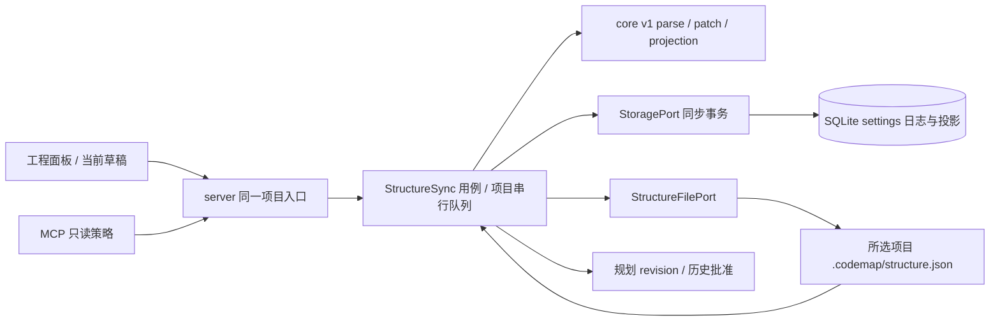

# POL-01：structure.json 双向同步与审计

日期：2026-10-10 UTC。状态：独立设计草案；首次独立审查 C0/I2/M2 已完成，本文作限定修订后待复审，产品尚未实施。主任务负责集成、实施授权、阶段提交和推送。

## 目标与已确认范围

用户在工程面板修改目录说明后，能在所选项目的 `.codemap/structure.json`、重启后的 SQLite 和当前规划版本看到同一份结果；Git/编辑器修改文件后，应用读取新内容并明确提示过期草稿。失败不产生半个 JSON，不静默覆盖冲突或非法文件。服务只写这一个授权元数据文件，不修改目标源码。

POL-01 的依赖 UI-04 已完成。本票只做 v1 读取、schema 校验、规范化、双向写入、来源/摘要审计及同步状态展示。自然语言职责与显式机器规则分开呈现。POL-02 的 allowed/forbidden 编辑、有理由例外及新的规则执行器仍留在 POL-02；本票保留它们的已有数据，不把保留或 schema 校验称为规则满足。独立任务 GRP-02 正在修改共享 core/service/routes/workspace，实施必须等其 freeze 后顺序集成。

## 现场事实

- README 第 9 节定义 v1：`folders[{path,purpose,allowed?,forbidden?}]`、`dependencyRules[{from,mustNotImport,reason}]`；现役仓库文件已有两条省略 allowed/forbidden 的 folder，因此不能要求它们必填。
- `packages/core/src/model.ts` 的 `DirectoryPolicy` 只有 id/projectId/pathPrefix/purpose/forbiddenDependencies。最后一个字段表示被禁止的目标路径前缀，不是自然语言 forbidden，也不是包导入 specifier。
- `Knowledge.savePolicy` 目前只写 SQLite；语义改变在同一事务内将该项目所有 plan revision 增一、status 改为 draft，历史 approval 保留。等价路径/禁止前缀去重顺序改变不使批准失效。
- `StoragePort.transaction` 是同步 API，禁止 await；文件与 SQLite 无法共享一个原子事务。当前通用 records 表已有 settings 种类，可保存有命名空间的 typed 同步记录，无须本票扩 migration。
- HTTP GET/POST `/api/projects/:id/policies` 和 `PoliciesPanel` 是现有入口；MCP `get_folder_policies` 读取同一个 GET。现有实现没有 structure 文件读写、摘要或审计。

## 方案比较与选择

1. **只导出 SQLite**：改动小，但会丢失 v1 字段、外部更新和未知扩展，无法满足 roundtrip。
2. **文件为可移植来源，SQLite 为投影与可恢复日志（选择）**：完整保存 v1，保留旧路径策略，用摘要和 revision 约束 UI 更新；承认跨介质提交有短暂恢复窗口。
3. **新规则引擎与完整文件事务平台**：扩展能力强，超出本票。POL-01 不引入依赖扫描、watcher、协作平台或自动例外裁决。

## 数据合同与 roundtrip

### v1 模型

新增 core 纯模型 `StructureDocumentV1`，known 字段使用显式类型，同时每层对象保留任意 JSON 值的未知字段；JSON 值只含 null/boolean/有限 number/string/array/object。禁止靠 Zod strip 丢字段，禁止把任意对象 spread 到原型。未知字段在 root、folder、dependencyRule 及扩展嵌套层保持值不变。

| JSON 字段 | 应用含义与映射 | 本票判定能力 |
| --- | --- | --- |
| schemaVersion | 必须为数字 1 | 文件格式校验 |
| folders.path | 项目相对目录；内部规范化为无尾斜线前缀，根目录为 `""`，序列化为 `"."` | 路径格式校验 |
| folders.purpose | 目录职责字符串 | 显示“职责说明，待人工判断”；没有满足/通过标记 |
| folders.allowed / forbidden | 可选自然语言 string[]，保留省略与空数组的区别 | 只读显示、schema 校验；不生成禁止依赖 |
| dependencyRules.from | 非空项目相对 source pattern | 保留并展示；本票不执行 pattern |
| dependencyRules.mustNotImport | 非空字符串组成的数组；包名和 import specifier 原样保存 | schema 校验；明确“已同步，尚未执行检查” |
| dependencyRules.reason | 字符串 | 解释说明，不充当验证证据 |

folders 和 dependencyRules 必须是数组；每个 folder 的 path/purpose 必填，reason 必填但可为空，与现有 purpose 行为一致。folder 路径接受反斜线与尾斜线作输入规范化，拒绝绝对路径、盘符、控制字符和任何 `..` 段；规范化后重复 folder 路径拒绝。from 保留 glob 文本，只统一斜线，拒绝绝对路径、盘符、控制字符及 `..` 段；不要为了本票 invent 一套 glob 引擎。mustNotImport 不能按文件路径规范化。允许空列表，不把空列表理解为免除已有 legacy 路径策略。

读入上限 1 MiB UTF-8 bytes；无效 UTF-8、非法 JSON、重复对象 key、schemaVersion 非 1、错误字段类型、超过上限均返回带 JSON pointer/错误类的诊断，保留原 bytes。实现纯 parser 时须检测重复 key，不能让 JSON.parse 的最后值覆盖伪装为有效输入。UI 写入也应用同一限制。读取不重排、不补字段、不落盘；实际编辑才写两空格缩进 JSON 加末尾换行。roundtrip 要求 JSON 数据和值保持，格式/字节逐一保持只适用于无操作和失败路径。

`fileDigest` 是实际文件原始 bytes 的 SHA-256，缺失文件为 null；不可用 mtime 代替。`semanticDigest` 是规范化完整 document 的 canonical JSON SHA-256：object keys 排序，folders 按规范 path 排序，dependencyRules 按 canonical 内容排序；known 的 allowed/forbidden/mustNotImport 数组按字符串去重排序，仅用于摘要；未知 arrays 保持原顺序。序列化不把 canonical 排序/去重强加给 untouched 数据。未知字段改变保守视为语义改变。仅空白/object key 顺序等格式变化不使规划失效。

### 旧 DirectoryPolicy 与 v1 不混义

文件 folder 投影为 `DirectoryPolicy`：id=`makeId("structure-folder",projectId,normalizedPath)`、pathPrefix=path、purpose=purpose、forbiddenDependencies=[]。这些投影供既有读取接口兼容，禁止用旧 POST 编辑它们；编辑走 folder 操作。v1 的 forbidden 永不映射到 forbiddenDependencies。

已有 SQLite `policies` 记录称为 legacy 路径策略；继续参与既有程序检查，绝不在第一次读文件时删除。它们的可移植表达为命名扩展：

```json
{
  "x-atlasmode": {
    "schemaVersion": 1,
    "legacyPathPolicies": [
      {"id":"existing-id","pathPrefix":"src","purpose":"旧说明","forbiddenDependencies":["private"]}
    ]
  }
}
```

已有 DB-only 策略只在显式“迁移旧路径策略到文件”动作后写扩展。预览列出 DB-only 条数及各策略当前值，使用同一 digest/revision 前置条件；迁移保留 id、项目归属及前缀语义。在 existing extension 同 id 与 DB 值不等、同 extension 重复 id 或 reserved extension 类型/version 不兼容时拒绝迁移并展示冲突；不覆盖、不猜合并。非 reserved 的 x-atlasmode 字段保留。扩展 policies 缺少 projectId，读取时绑定当前项目；拒绝引用别项目的已知 id。

迁移完成在 finalize 同一事务内移除本次已移入文件的 legacy DB records、更新文件投影和失效当前批准；文件成为这些记录的唯一来源，其他未迁移记录保留。迁移前，编辑已知 DB-only id 仍修改原 DB record，绝不先写同 id extension，也不隐式迁移；编辑继续可用。该分支在同一项目队列内检查文件同步状态与两项前置条件，以一个同步 DB transaction 更新旧策略、structureRevision、审计及一次规划失效；文件 bytes/fileDigest 不变，UI 明示“旧路径策略，尚未迁移”。相同策略内容的 no-op 不增版本。用户编辑后，旧迁移预览的 structureRevision 失效，必须重新预览。

未迁移 DB records 与文件投影取并集；同 id 等值去重、不同值冲突并阻止写入。旧 POST 保留字段兼容但新增同步前置条件，统一路由到 StructureSync：已知 DB-only id 走上述受控旧来源编辑；已迁移 id 和显式新建策略写 extension。缺少前置条件返回 428，不能有未经 StructureSync 新鲜度/审计检查的 DB-only 旁路。未经 preview/显式迁移不得删除 DB-only 记录；迁移失败、恢复 beforeDigest 分支均保留原 DB 和原 bytes，afterDigest 恢复在 finalize 中仅删除 intent 记录的迁移 id。folder 更新不重命名或删除 legacy 策略。

## 分层与接口



core 新文件 `structure.ts` 承担 schema、规范化、patch 和 projection，不做 I/O；`structure-types.ts` 承担模型/port。storage 新 `structure-file.ts` 是文件适配器（该包原本已有 mkdir/read I/O），经公共 index 导出；server 负责注入。service 新 `structure-sync.ts` 编排，`structure-state.ts` 管理 settings 命名记录/审计/一次性 finalize，避免扩大 Knowledge 混合职责。

服务接口：`getStructure(projectId): Promise<StructureState>`；`updateStructure(projectId,input: StructureWriteInput): Promise<StructureState>`；`listStructureAudit(projectId,{offset,limit}): StructureAuditPage`；`recoverStructureWrites(): Promise<StructureRecoverySummary>`。Workspace 增加 `readApprovedPlan(planId): Promise<PlanDetail>`，将真实刷新、结构检查与有效批准读取放在一个项目队列任务内。生产 server 必须注入 StructureFilePort；未注入 port 的旧 unit fixture 可继续只测旧内存语义，但真实 HTTP 写入拒绝 `STRUCTURE_UNAVAILABLE`，不能回落为无同步检查的 DB-only 写。

`StructureState` 包含 projectId、schemaVersion、document（仅有效时）、structureRevision、fileDigest、semanticDigest、verifiedAt、status=`ready|missing|invalid|conflict|recovery_pending|unavailable`、diagnostics、legacyPendingCount。初次 missing 为 revision 0；每次观察到 raw digest 改变增一次 structureRevision（包含 invalid/删除），受控 DB-only 策略语义编辑也增一次；semanticDigest 始终只表示完整 normalized document，在 invalid 时为 null，不另造去来源差异摘要。失效状态保留 lastGood 元数据供“旧副本”只读展示，不能呈现为当前有效。`StructureWriteInput` 包含 mutationId UUID、expectedStructureRevision、expectedFileDigest（null 表示明确期望缺失）、operation；operation 为 upsertFolder `{previousPath?,path,purpose}`、upsertLegacyPolicy `{id?,pathPrefix,purpose,forbiddenDependencies}` 或 importLegacy。只编辑明确 owned 字段，UI 不提交完整 document，因此未知内容不因旧表单而丢失。upsertFolder 保留原 allowed/forbidden/未知字段；path 改名也保留这些字段。

GET `/api/projects/:id/structure` 刷新文件；PUT 同路径提交 write input；GET `/structure/audit?offset=0&limit=50`，limit 1–100，审计按 UTC time/id 倒序。GET policies 保留数组形状并先等待同步，invalid/conflict/pending 时返回相应错误而非无标记 stale 数组。POST policies 增加 mutationId 和两项前置条件，调用同一 StructureSync 来源分支。MCP 仍没有策略写工具；get_folder_policies 保留原分页结果，附 structureRevision/fileDigest/verifiedAt/status，并使 invalid 等状态明确失败。get_approved_plan 的 HTTP handler 调用一个 readApprovedPlan 用例，不能用“刷新完成、释放队列、再读批准”的两步拼接代替。

## 同步、并发与恢复

### 接受外部文件

在 open/select、GET structure/policies、显式 refresh、approve/verify、MCP get_folder_policies/get_approved_plan 的新鲜度入口重新读取文件；没有 watcher。业务读写在同一项目串行队列内，digest 与 raw document 同一次读取。合法 changed bytes：一个同步 SQLite 事务保存新 state、更新投影、记录 source=external audit；若完整文件 semanticDigest 变化，该项目每个 plan revision 仅增一次并置 draft，保留 approval。任何含至少一条 DB 来源切换的实际显式迁移同样触发一次失效，即使规则看似等价，或 extension 已存在等值记录而 document 摘要未变；immutable 历史 approval 不改写。DB-only 策略实际语义编辑沿用现役规则独立触发一次失效，不假称文件摘要改变。三个触发条件在同次 finalize 取逻辑或，只增一次。零条迁移是 no-op。首次引入真实文件也视为上下文改变；格式变化仅更新 structureRevision、digest、审计。缺失文件是 missing，不自动创建；此前存在文件突然删除是外部上下文变化，应记录并使规划过期，保留 legacy DB records。invalid 文件不覆盖 lastGood 投影，第一次从有效变 invalid 使该项目 plan 失效一次，不允许批准/核对/写入，不能悄悄回用旧检查结果；相同 invalid digest 的重复读取不再增 revision。

approvePlan、verifyPlan、readApprovedPlan 的实际索引刷新、lock-held 结构读取/恢复/检查、同步批准提交或有效性读取必须一直持有同一项目队列边界。不得在 refreshIndex 返回释放队列后再 approve/read。准备/发布/待 finalize 的结构写与这些用例互斥；pending 无法恢复时明确503，已发生语义编辑时旧 expectedPlanRevision 得到409，而非有效旧批准。测试用可控 Promise barrier 和“审批尚未 settled”断言证明交错；不用时间 sleep 证明互斥。批准历史导出仍可读取，必须清楚标历史，不能冒充当前有效批准。

### UI 写入步骤

1. 项目串行队列内读 actual bytes，恢复该项目未终结 intent，再与两项 expected 值比较。不一致返回 409 `STRUCTURE_CONFLICT`，不自动重放 UI 输入。
2. parse/schema/path 检查，按真实来源分支。已有 DB-only id 的编辑只走本节前述受控 DB transaction，不创建文件候选；其余 operation 才 apply document 并验证 candidate。语义/actual内容不变且没有迁移id时返回现态，不写文件、不增 plan revision、不生成虚假写入审计。若等值extension已覆盖全部迁移id，document完全不变，则只在同步finalize事务切换这些id的来源、记录migration审计、structureRevision/plan各+1，不重写文件或创建before==after的含糊发布intent。mutationId相同且相同请求重试返回已有outcome，不同请求同id返回冲突。
3. 文件写分支用一个同步 DB transaction 写 `prepared` intent，包含 mutationId/requestDigest、projectId、source、operation、beforeDigest、afterDigest（候选）、before/after semanticDigest、before bytes 与 candidate bytes、迁移 id/value 清单、验证时刻；不提前更新 policy 投影或 plan。before/candidate bytes 各最多1 MiB，仅用于 bounded 恢复证据，不自动回写旧内容。
4. adapter 在真实 `.codemap` 同目录创建唯一 temp，写完整 bytes、fsync、close，立即重读目标核对 beforeDigest，再 rename 覆盖；不存在文件使用 expected null 校验。采用适配器返回的实际发布阶段，不凭捕获异常推断 rename 未发生。前置任何失败保留原 bytes，intent 记 failed。
5. rename 后读 actual bytes 验证 afterDigest。一个同步 transaction 保存 state/投影、迁移删除（若有）、一次 plan invalidation、成功审计并将 intent finalize。回复只在 finalize 成功后发送；提交后日志 phase=committed，重复恢复不增第二次 revision。

任一文件已 rename 而 DB finalize 失败/进程退出，状态 recovery_pending；503 明确“文件已更新，数据库待恢复”，不能给“未保存”的误导反馈。不得自动把 before bytes 写回，因为外部编辑可能已发生。每项目最多一个未终结 intent、每 candidate 最大 1 MiB；后续写入阻塞至恢复。已终结 audit 不含原文件全文或源码，不删除历史证据。

启动在 listen 之前遍历已知项目 intent（最多每项目一条）执行 recovery；单项目 invalid/conflict 标记不可写，其他项目可启动。读/写/approve 前也执行对应项目 recovery。disk digest==afterDigest 时一次性 finalize（source 保持原 ui/legacy_migration，recoveredAt 记录实际恢复时间）；==beforeDigest 时标记 aborted 并保留旧 state，绝不自行重放 candidate；其他 digest 或非法 bytes 则标 conflict，保留真实外部文件与 intent，读状态提供诊断。用户显式刷新接受有效外部版本可解决 conflict：先记 interrupted mutation 的 conflicted 审计，再同步外部文件并终结 intent，不覆盖 disk。invalid 时须用户先修复文件；本票没有强制覆盖按钮。

settings keys 固定为 `structure:state:<projectId>`、`structure:intent:<projectId>`、`structure:audit:<projectId>:<mutationId>`。所有写和 finalize 使用 StoragePort.transaction 的同步边界，await 只发生在事务外。source 值只能由 server/use-case 赋为 ui/external/legacy_migration；客户端不能指定 source、verifiedAt、audit 或 projectId。audit 包含 id/projectId/source/outcome/target=`file|legacy_db`、beforeDigest（操作开始观察到的真实 bytes）、attemptedAfterDigest（文件候选；无文件写入操作为null）、observedAfterDigest（终结或失败时实际重读结果）、observedAfterKnown（不可读取时false而不是把null伪装为文件缺失）、before/attempted semanticDigest、validatedAt、observedAt?、committedAt?、recoveredAt?、结构 revision、受影响 plan id/revision、errorCode?。legacy_db 编辑审计另含 policyId/beforePolicyDigest/afterPolicyDigest；等值extension来源迁移审计另含实际migrationIds，均断言fileDigest与bytes未变。file成功时 observedAfterDigest==attemptedAfterDigest；A→candidate B、外部改C导致失败时必须分别记录B与C，不把B标为已写入。failed/conflicted没有 committedAt。prepared保留原bytes与候选bytes供复核，terminal audit只保存摘要和来源，不复制全文。审计证明“谁从哪个入口写、字节摘要何时校验”，不证明自然语言职责满足。

### 原子性与真实限制

原子 rename 保证读者只看到完整旧/新 JSON；写/fsync/rename 前失败原 bytes 保留。发布后发生 directory fsync 错误或 DB 错误归 recovery_pending，不能宣称原文件未变。保留既有文件权限，创建文件默认仅宿主用户读写；Windows/Linux/macOS 平台差异须实际 adapter 测试，不能用先 delete 再 rename 退化实现。拒绝目标文件及 `.codemap` 越界/符号链接，不写任意客户端路径。

承诺并发范围是同一 AtlasMode 服务的所有合作写者：项目队列 + digest/revision CAS 保证一个旧版本只有一个成功结果。首版不支持两个 server 对同一项目同时写入，不新增跨平台文件锁/租约系统；集成文档与运行入口须明确单写者要求，测试不把两个独立 server 的写入冒充已保证场景。独立 server 与编辑器同属未参与者。这一限制避免遗留 lock 阻断本票要求的正常启动日志恢复；若未来要多写者，必须另做合作锁协议。

任意外部编辑器不参与项目串行队列；digest 重检与 rename 之间仍有真实 TOCTOU 窗口。检测到的外部改动必定 conflict，发布后摘要不同必定 conflict；没有通用跨平台方式保证未参与者不会在最后一次重检后写入，因此本票不宣传文件系统级 CAS 或无丢失多进程协作。用户应在保存期间避免同时从编辑器写同一文件。实现与审查必须保留这一限制，不用 sleep-based 测试伪证消除它。

## UI 行为

沿用显式打开的工程面板，在顶部显示来源 `.codemap/structure.json`、schema v1、最近验证时间与简短 digest。folder 表单只编辑路径/职责；allowed/forbidden 与 dependencyRules 是只读详情，分别标“职责说明，待人工判断”和“导入约束，已同步但尚未执行检查”。旧路径策略表单保留，明确“禁止目标路径（现有程序检查）”及真实DB-only/文件来源；DB-only同id编辑仍保留原DB，新建或已迁移记录写命名扩展。DB-only列表提供实际可用的显式迁移预览/确认按钮，不把它们藏掉或自动删除。

409 保留用户输入，显示“文件或目录约定已更新，请重新读取后核对再保存”；重新读取更新版本，同时仍保留未提交内容供核对，不自动 retry。invalid/pending/conflict 禁用保存和批准，展示错误定位；missing 显示“尚无文件，保存会创建”，第一次保存使用 null 摘要。保存成功刷新同项目 policies/plans，当前 plan 使用实际返回 revision；项目切换后晚到响应不能污染新项目。历史 approval 继续显示原版本，当前 draft 明确待重新确认。中英文文案、键盘与窄面板沿用已有组件习惯。

## 验收门

| 编号 | 必须提供的行为证据 |
| --- | --- |
| A1 | 实际仓库 v1 与省略可选字段通过；root/folder/rule/扩展未知值 read→edit→serialize→read 保留；非法 JSON/重复 key/版本/路径/类型逐项拒绝且 bytes 不变 |
| A2 | UI 文件保存后 disk digest、SQLite state/projection、HTTP/MCP 元数据一致；语义一次修改或实际显式迁移只增本项目 plan revision 一次，历史 approval 保留；格式/no-op 不增 plan revision；DB-only编辑保持文件bytes/digest不变并使当前plan失效 |
| A3 | 外部合法编辑被 read/refresh/approval 检测；两个同版本并发 UI 保存恰一成功、一409，旧输入保留；invalid/deletion 不让 stale approval 显示为可用 |
| A4 | temp/write/fsync/rename 前故障原 bytes 保留；实际并发 reader 不见半 JSON；rename 后 DB fail/crash restart 按 before/after/third digest 分支恢复，无二次失效、无第三方覆盖；prepared/发布待finalize与批准/有效批准读的确定性barrier交错不得给有效旧批准 |
| A5 | 每次接受/失败/恢复的 audit 来源、before真实SHA、attempted候选SHA与observed实际SHA明确分开、验证时刻/outcome可查；A→B候选被外部C冲突时记录三者；客户端伪造 source/time 拒绝；项目隔离、symlink 越界拒绝 |
| A6 | 旧 policy 不丢、不误映射；DB-only同id编辑→显式预览迁移→同事务来源切换→extension再编辑→重启全程可用；失败/恢复不删错DB记录；迁移plan+1且history不变；扩展冲突不静默合并；自然语言/未执行 import rule 不出现“通过” |
| A7 | 真实 Chromium 创建临时目标、打开面板、编辑→文件与SQLite实查→重载/ownedserver重启→外部改→冲突输入保留→重新读取再保存；实际查看中英文/窄面板截图 |

本轮只写 spec/plan：上述产品门尚未运行。未来实现需定向 meaningful tests、相关 build/typecheck/lint 和一个真实浏览器闭环；root 集成检查由 main 协调，避免重跑无关索引/Provider gate。测试临时目录、SQLite、截图及失败凭证保留，生成记忆只读。

## 决策与交接

文件来源、v1 映射、unknown 保留、命名 legacy 扩展、显式迁移、同步日志恢复和 no-new-engine 均已按现有授权自主明确，无需再问用户；多 server 写入、任意编辑器原子 CAS、规则引擎与例外不纳入本票。main 需要协调共享文件：core/model.ts 和 index.ts；service/knowledge.ts、workspace.ts、index.ts；server/index.ts、routes.ts、server.ts；web/workspace.ts、api/client.ts、i18n/{zh,en}.ts；mcp/server.ts。新增专用文件可独立，shared edits 等 GRP-02 freeze 后串行。只 main 可阶段 commit/push；本设计者不改 global docs、不改 generated memory、不清理复核现场。

自审：模型映射没有将自然语言/包 specifier 误装为路径；完整 JSON 与旧库数据均有保留路径；成功只在 DB finalize 后；事务不含 await；恢复各分支不重放 candidate；产品限制与门证据分开，POL-02 范围未偷跑。

限定修订：I1补齐迁移前受控DB同id编辑及finalize来源切换；I2采用main保守裁决，实际迁移使当前批准失效，不引入新context digest；M1批准提交/有效读取在同一lock-held队列任务，M2审计明确候选/实际摘要。首次独立审查原文保存于 `docs/reviews/pol01/2026-10-10-independent-design-review.md`，不改历史结论；限定复审尚未发生。
