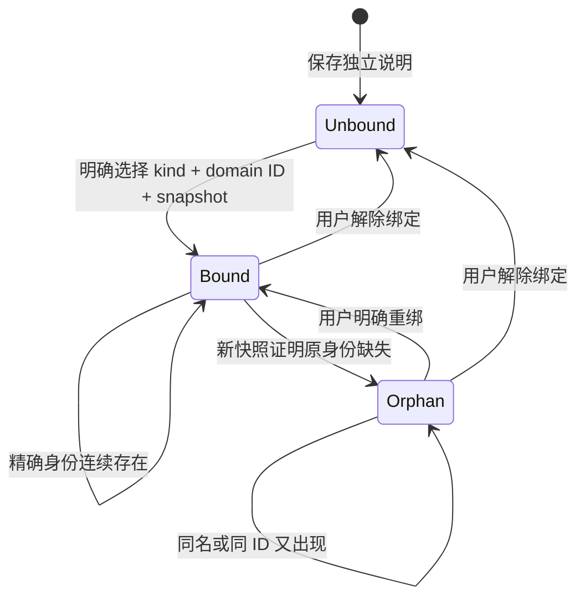

# KN-01 独立注释与失联重新绑定设计

日期：2026-10-10 UTC。状态：设计/计划交接，产品实现未开始，未执行本设计的运行验收。对应 [KN-01](../../tickets/KN-01.md)；实施顺序见 [计划](../plans/2026-10-10-kn01.md)。

## 目标与约束

用户在浏览真实源码时，可以独立保存作者、来源、说明及约束，无需先创建规划。源码消失后知识仍可读、编辑并保留历史；重绑只接受用户明确选中的项目、事实类型、domain ID 与当前快照，不按同名、路径相似或代码相似猜测身份。

本轮仅盘点并新增这份 spec 和对应 plan。当前分支 `fix/first-use-20261010`，读取时 HEAD `cfda22b`；工作区有并行 GRP-02 等未提交修改，盘点基于当时实际源码，实施前须重读共享接口。保留已有 AGENTS.md 修改。产品实施窗口、集中复核和 stage/commit/push 由主任务协调。

KN-02 负责 schemaVersion 知识导出/导入与冲突预览；DATA-01 负责一致备份/恢复。本票不实现二者，不自动迁移旧规划 annotate 为知识，不改目标源码、索引身份算法、分组成员、目录约束解释器或 Agent 自动执行能力。

## 当前事实与差距

| 已读取的事实面 | 证据与结论 |
| --- | --- |
| 模型 | `packages/core/src/model.ts` 只有 `Operation.annotate {targetId,text}`，没有独立 Annotation，也没有 annotations RecordKind。README 的 Annotation 实体尚未实现。 |
| UI 注释 | `features/planning/PlanEditor.tsx` 将注释追加到当前规划；`operations.ts::deleteTemporary` 保留 annotate；`validation.ts::validatePlan` 对消失目标报 INVALID_TARGET，PlanEditor 显示失联。它不是独立知识 CRUD/重绑。 |
| 知识 | `service/src/knowledge.ts` 只有 routes、views、groups、policies；group/policy 语义改变会在同一事务中让本项目每条当前 plan revision+1/draft。未提供独立注释删除、CAS 或历史。 |
| 索引刷新 | `WorkspaceService.storeSnapshot` 事务保存新快照并更换项目指针，保留旧 snapshots、groups、routes、plans。现有生命周期测试验证这些对象保留，未验证独立注释。 |
| SQLite | `storage/migrations/001-records.sql` 的 kind CHECK 不含 annotations；`sqlite.ts` 只执行 001-records。仅增加 TS union 会在真实写入时失败。 |
| JSON | SQLite records.value 保存 JSON，settings 保存 `approved-plan:<approval.id>`。现有 `exportPlan` 导出的是规划及历史批准规划；没有可工作的 `.codemap/knowledge.json` 知识导入/导出。 |
| 批准 | `Planning.approve/latest/export` 保存并校验不可变 approved-plan 和 Approval；当前 knowledge 变化不改旧批准，但尚未捕获独立注释的批准时内容。 |
| 可用性 | `indexer/src/scan.ts` 保存 coverage.availability（complete/unavailablePaths/excludedPaths）；`verification.ts` 已把缺失、排除、诊断和旧快照证据不足区别处理。浏览器局部图未加载或 HTTP 失败不能证明源码删除。 |

上述为只读源码盘点，未声称新功能已运行。已有历史测试只是定位线索，本轮未重跑产品测试。

## 方案选择

1. **独立实体、精确绑定、失联锁存（采用）**：增加独立 Annotation，服务端解析当前快照身份；发现已证明缺失时持久化 orphan。新增少量 schema/service/UI 接口，满足完整生命周期及并发边界。
2. 在 Plan.operations 上补作者与重绑：改动较少，但用户仍必须创建规划，无法满足独立知识和独立删除/修订。
3. 自动相似度迁移：可减少点击，但会把旧知识关联到未经选择的新代码，违反明确身份约束。

## 模型与状态

`Annotation` 在 core 中定义：

```ts
type AnnotationTarget = { kind: "node" | "relation"; id: string };
type AnnotationSelection = { snapshotId: string; target: AnnotationTarget };
type AnnotationBinding = {
  target: AnnotationTarget;
  selectedSnapshotId: string;
  lastKnown: { label: string; filePath: string; nodeKind?: "function" | "file" | "folder" };
} & ({ state: "bound" } | { state: "orphan"; orphanedAtSnapshotId: string });
type Annotation = {
  id: string; projectId: string; revision: number;
  text: string; author: string; source: "user" | "agent"; isConstraint: boolean;
  binding: AnnotationBinding | null;
  createdAt: string; updatedAt: string; deletedAt?: string;
};
type AnnotationRevision = {
  annotation: Annotation;
  action: "create" | "edit" | "bind" | "detach" | "orphan" | "delete";
  recordedAt: string;
};
```

作者是用户输入的显示署名，不是已验证登录身份。source 标记记录创建来源，创建后不可修改；author 可编辑，历史保留旧署名。UI 默认 source=user、author=用户/User，用户可更改署名；HTTP 可创建 source=agent 的注明来源记录。author 去首尾空白后 1–200 字符，text 1–20,000 字符（空白文本拒绝，合法正文保留原文），id 1–200 字符，revision 为正 safe integer。未知字段拒绝；revision、时间、绑定摘要和历史均由服务端生成。约束是供人和 Agent 阅读的文本要求，不自动成为 calls、must_call 或目录禁止依赖规则。

MVP 支持当前索引中的 function/file/folder node 和事实 relation；不支持 external、规划 temp ID、React Flow 展示 ID、分组镜像 ID。group 注释继续沿用 group.description；跨票扩大 target kind 后另行设计。节点、关系 namespace 用 kind 区分，不把普通连线变成源码调用。

读返回 `AnnotationDetail {annotation, resolution}`；resolution 为 `{status:"bound"|"orphan"|"unbound"|"unknown", snapshotId?:string, reason?:string, target?:CodeNode|Relation}`。只表示在该已索引快照中的状态，不承诺文件此刻仍在磁盘。GET 无法取得已存快照时返回 unknown 及记录正文，不丢知识；项目不存在返回 NOT_FOUND。没有局部图节点不等于 orphan。



orphan 锁存：首次明确缺失后，刷新不能自动恢复 bound，即使原 ID 又出现。连续快照中相同 ID 始终存在则保持绑定，原 selectedSnapshotId/lastKnown 是选择时的历史来源，不每次刷新覆写。两次索引之间发生且恢复的删除无法被快照系统观测，不宣称检测该情况。

`reconcileAnnotationBindings(annotations, snapshot)` 是 core 纯函数，只给出 bound→orphan 的更新；只对本项目且未删除记录处理。target 缺失且相关路径没有诊断、未被排除、没有 unavailable、availability.complete=true 时，才能记录 orphan。旧快照缺 availability、排除范围、解析失败、未完成扫描均保持持久化状态不变，读显示 unknown。路径触碰规则为同路径或子路径；relation 使用选择时 evidence.filePath，folder 使用文件夹路径。刷新整体失败保留原记录和原快照，UI 显示刷新失败，知识面板仍能打开。

## 持久化、并发与批准

新增 `annotations` RecordKind。**SQLite 支持前提**：数据库由单个服务独占拥有，初始化/迁移及日常使用期间没有外部并发 writer；不支持其他进程同时写入或修改数据库/schema/sidecars。标准 SQLite VFS 不能将最后一次文件指纹比较与随后 open/BEGIN IMMEDIATE 原子耦合，本实现不声称能锁住任意外部 writer，也不保证该不受支持竞态中的零 sidecar 写。任何已经观察到的文件内容/identity变化必须在打开原 SQLite 连接前 fail closed：成功 initial stat 后 read 或 after-stat 的 ENOENT 是 `OBSERVED_CHANGE`，不能当 absent；只有 initial stat 的 ENOENT 可以表示起初不存在。

**迁移前 schema gate** 只接受三个精确已知状态：empty（无产品表/marker/额外 schema object）、001（marker 恰为 `001-records` 且对应原 records/migrations schema）、002（marker 恰为 `001-records`+`002-annotations` 且对应本版本扩展 schema）。原数据库只通过 raw 文件读取；完整 main+WAL+journal 副本在自有临时目录中由 SQLite 校验，SHM 是派生 index，由副本重建，不信任源 SHM，不用 immutable main 忽略已提交 WAL。多次比较原 main/WAL/SHM/journal 的完整字节及文件 identity，在副本校验前、关闭清理副本后、移交可写连接前拒绝已观察变化；仅清理自有副本。必须在任何原库 `CREATE TABLE`、迁移 DDL 或 `PRAGMA journal_mode=WAL` 等持久写前完成 gate；随后写连接的同步事务内重新检查，拒绝事务内发现的 schema 不匹配并回滚。新文件初始化也先按 empty 验证。未知 future marker（如003）、marker与schema不一致、未知kind/CHECK、附加trigger/view/table/index均抛 `UNSUPPORTED_SCHEMA`，关闭连接，不能尝试重建、删对象、改marker或修数据。在上述单服务、无外部并发 writer 支持前提下，拒绝未知schema保持原数据库持久数据字节、sqlite_schema、marker和JSON值原状，不新增/删除/清理原 sidecars；普通 SQLite readonly 连接仍可能写 sidecars，不可作为源文件零写证明。

known schema 不能仅以 marker 存在判定：核对 `sqlite_schema` 的已知建表DDL、`PRAGMA table_info/index_list/index_info` 的列/NOT NULL/主键/自动索引，以及 json_valid和kind CHECK；只允许可信001 SQL或002迁移产出的精确schema fingerprint，DDL规范化只处理引号外空白，不能抹掉literal/CHECK差异。仅允许两张产品表与其必需sqlite自动索引，没有自定义trigger/index/view。读取原始行确认kind属于该版本集合；任何不匹配都拒绝，不把未知schema“升级”为已知。已知002重复开启只验证，不重建；同时验证下文legacy registry存在、version=1且结构合法。

仅对已知001执行002：同步事务内重建 records CHECK（保留原有全部kind）、SQL原样复制 `rowid,kind,id,value` 后替换表、建立legacy registry、最后写002 marker；旧001内容不改。不经 JSON.parse/stringify 回写旧value，保留原非canonical JSON空白/key order和 `hex(CAST(value AS BLOB))`、rowid，旧Approval/settings原样保留。JSON/主键约束不弱化；异常整个事务回滚，真实旧001、新库、重复开启均测。不得为迁移删除数据库、知识或批准。

当前实体存 annotations；每次成功修订在 settings 新建 `annotation-revision:<id>:<revision>` 不可变完整 AnnotationRevision。先检查键不存在再插入；碰撞失败回滚，不能 put 覆盖历史。创建为 r1，文本/署名/约束编辑、绑定、解除、orphan、显式删除为 r+1；完全相同的内容/绑定提交是 no-op，先检查 CAS，不写时间、不失效规划。删除是 deletedAt tombstone，默认列表隐藏，历史仍可查；源码删除绝不触发 tombstone。历史无自动清理或保留数截断。

所有写要求 expectedRevision（创建除外）；服务在同一同步 SQLite transaction 内重新读当前 record，确认 project 归属、未显式删除、revision 相等，再校验和写记录、历史及规划失效。过期 CAS 返回 REVISION_CONFLICT/409；不自动合并或覆盖。跨项目注释 ID 返回 NOT_FOUND，不泄露其他项目记录。绑定必须同时在事务内检查项目当前快照 ID 等于提交 snapshotId；否则 SNAPSHOT_CHANGED/409；再检查该 kind+domain ID 真存在且目标可用，拒绝不可用/错误类型/展示 ID。text 编辑和显式删除不依赖源码存在，解除绑定不要求源码快照。

Annotation text、author、isConstraint、绑定目标/绑定状态以及创建/删除都是评审上下文语义变化，沿用 Knowledge 的保守界限：本项目每条当前 plan revision+1、status=draft、updatedAt 更新，其他项目不变。即使没有触及该注释的操作也失效。刷新将多条注释转 orphan 时，一次事务每条 plan 只增加一次；快照写、project 指针、注释历史、规划失效整体回滚。当前 PlanDetail 仍可能因基线不同显示 stale；不可冒充 approved。只刷新而无注释状态变化时沿用现有 baseline freshness，不重复改 plan revision。

### Versioned 审核上下文与真实摘要校验

现有 `semanticHash(plan)` 保持 SHA-256(semanticPlanContent(plan))，旧Approval的值和批准规划原样保留，不能伪称这个plan-only hash包含注释。新 `Approval` 必须增加 `reviewContext: { version: 1; knowledgeHash: string }`（64位小写hex），并在 `settings/approved-annotations:<approval.id>` 保存 `ApprovedAnnotationContext {version:1,projectId,snapshotId,annotations:Annotation[]}`，是当时全部未删除记录的完整副本，含unbound/orphan及其provenance。旧record可缺reviewContext，但新approve永远不能省略；未知version、部分/多余字段拒绝。

摘要算法固定为 `SHA-256(UTF8("atlasmode-annotation-review-v1") || 0x00 || UTF8(canonicalAnnotationContext(context)))`，其中0x00为单个NUL byte，canonical函数输出以下显式字段顺序数组的 JSON.stringify 结果：

```ts
[
  1, context.projectId, context.snapshotId,
  [...context.annotations].sort(byIdLexical).map(n => [
    n.id, n.projectId, n.text, n.author, n.source, n.isConstraint,
    n.binding === null ? null : [
      n.binding.target.kind, n.binding.target.id,
      n.binding.selectedSnapshotId,
      n.binding.lastKnown.label, n.binding.lastKnown.filePath,
      n.binding.lastKnown.nodeKind ?? null,
      n.binding.state,
      n.binding.state === "orphan" ? n.binding.orphanedAtSnapshotId : null,
    ],
  ]),
]
```

排序用复制数组、raw ID的JavaScript UTF-16 code-unit字典序（`a.id < b.id`），不依赖locale、不改capture数组；重复id/跨project记录/非法schema/deleted记录拒绝。正文/署名保持合法存储值，不在hash阶段重新trim。纳入正文、作者、来源、约束、绑定kind/domain ID、选择快照、lastKnown及orphan证据；排除Annotation revision、createdAt/updatedAt/deletedAt这类CAS/时间元数据和UI坐标。context projectId/snapshotId/version纳入摘要；完整存储payload仍严格schema验证。数组/对象key顺序变化不改变hash，语义字段改变必须改变hash。

`approve` 的同一同步事务顺序：重读plan/CAS及当前baseline → capture活跃注释并严格校验 → 计算plan semanticHash和knowledgeHash → 生成新Approval → 检查所有历史key/Approval ID未存在 → 插入approved-plan、approved-annotations、Approval及当前approved plan。任意capture/hash/插入/当前plan写失败全部回滚。不得先存批准后异步补capture，也不得put覆盖旧上下文或批准。

统一 `validateApprovalContext(approval, approvedPlan, context, legacyIds)` 校验项目、planId/revision/plan hash、baselineSnapshotId/contentHash，以及v1 context version/projectId/snapshotId=批准baseline/hash。`Planning.latest/get/export`、`WorkspaceService.verifyPlan`及后续Agent批准tuple检查必须调用该真实guard。历史验证只用不可变context；current get另计算当前活跃知识在当前snapshot的knowledgeHash，只有它等于批准knowledgeHash、现有revision/plan hash/baseline全部相符才valid。即使写入漏了revision失效，也不能靠plan-only hash通过。

new-v1 context缺失、语义篡改、hash不符、未知版本或对应批准payload损坏一律fail closed：get显示valid=false及`APPROVAL_CONTEXT_INVALID` issue；latest/verify/export或授权操作返回该DomainError（HTTP409），不能跳过该异常批准并fallback旧Approval，更不能从当前注释回填/重算旧hash。编辑/重绑/删除始终保留原批准context及history。

legacy兼容不是看“字段缺失”就降级：002迁移在同一事务内一次冻结迁移前已有Approval record IDs，存 `settings/annotation-review-legacy-v1` 的 `{version:1,approvalIds:string[]}`，新库为空；重复开启不重算、不追加。仅登记的ID且完全没有reviewContext、没有approved-annotations key可按原plan-only算法验证，输出“历史注释上下文未记录”；任何新ID缺version/context必须拒绝，防止删除version字段变成legacy。registry缺失/损坏拒绝打开已知002，不自动重建。旧批准继续可历史verify/export，不授权需要注释审核的源码实施；取得v1 context需显式重新批准。

plan JSON/Markdown 导出新context连同reviewContext version/knowledgeHash，旧记录省略context并给明确未记录说明。此处是已有plan导出的批准证据扩展，不是KN-02知识导出协议。主任务在KN-01集成后须同步AG-02接点：ticket/run tuple pin `reviewContext.version=1`+`knowledgeHash`，issue/start/generation后apply preflight/recovery校验都复用guard、比较当前hash；legacy/缺失/篡改不准执行，不只检查旧 `{revision,semanticHash,baseline}` tuple。

## 服务与 HTTP 合同

独立 `packages/service/src/annotations.ts::Annotations` 管理记录、历史、解析和审批上下文；复用 Knowledge 的本项目 plan 失效规则，提取小型 `knowledge-revisions.ts::invalidateProjectPlans(storage,projectId,now)`，group/policy 语义保持原样。WorkspaceService 创建该组件并提供以下 facade；不要把复杂新逻辑塞进共享 knowledge.ts。

```ts
type AnnotationContent = { text: string; author: string; isConstraint: boolean };
type CreateAnnotationInput = AnnotationContent & {
  source: "user" | "agent"; binding: AnnotationSelection | null;
};
type UpdateAnnotationInput = AnnotationContent & { expectedRevision: number };
type BindAnnotationInput =
  | { expectedRevision: number; target: null }
  | { expectedRevision: number; target: AnnotationTarget; snapshotId: string };
type AnnotationListInput = { offset?: number; limit?: number; status?: "orphan" };
type AnnotationPage = {
  items: AnnotationDetail[]; total: number; offset: number; limit: number; truncated: boolean;
  snapshotId?: string;
};
type AnnotationHistoryPage = {
  items: AnnotationRevision[]; total: number; offset: number; limit: number; truncated: boolean;
};
type DeleteAnnotationResult = { id: string; revision: number; deletedAt: string };
```

| Facade | HTTP |
| --- | --- |
| `listAnnotations(projectId,input): AnnotationPage` | GET `/api/projects/:id/annotations?offset=0&limit=20[&status=orphan]` |
| `getAnnotation(projectId,annotationId): AnnotationDetail` | GET `/api/projects/:id/annotations/:annotationId` |
| `createAnnotation(projectId,input): AnnotationDetail` | POST collection |
| `updateAnnotation(projectId,annotationId,input): AnnotationDetail` | PUT record |
| `bindAnnotation(projectId,annotationId,input): AnnotationDetail` | PUT record `/binding` |
| `deleteAnnotation(projectId,annotationId,expectedRevision): DeleteAnnotationResult` | DELETE record，JSON body `{expectedRevision}` |
| `annotationHistory(projectId,annotationId,input): AnnotationHistoryPage` | GET record `/history?offset=0&limit=20`，已删除记录仍可查 |

默认 page=20，最大100；非负 safe offset，正 safe limit；升序 createdAt+id，history 按 revision 降序。严格 params/query/body。绑定修改 endpoint 不能携带 text，内容修改不能携带 binding，防止隐式换目标。绑定 ID 解析失败 INVALID_INPUT/400；快照冲突 SNAPSHOT_CHANGED/409；记录不存在/越项目 NOT_FOUND/404；服务失败500与网络错误不能显示“源码已消失”。不增加新全局依赖、认证或外部网络调用。KN-01 只交付 HTTP/Service/Web 入口，不增加 MCP 或 Agent tool allowlist；未来适配器必须沿用这些 CAS/显式绑定合同。

## 用户路径与 UI

在 Navigation 现有高级管理区旁新增可打开的“独立注释 / Annotations”，打开后分页20项，可保存未绑定注释，无须当前 plan。正文、作者、来源、约束 badge、revision 与绑定状态可见。保持首用默认双 Chat 和中心图布局；新增独立 `features/annotations/AnnotationsPanel.tsx` 与样式，不改 graph projection。

创建/编辑显示“作者”“说明”“作为约束”；source 为只读创建来源。用户可显式选择“绑定当前事实”，从已加载且 snapshot 相符的 selectedNode 或 relation 获取 domain identity；显示类型、文件路径、domain ID、snapshotId 后，点击“确认绑定 / Confirm binding”。取消不写。没有合法选择时可保存未绑定内容。

orphan 行显示“失联，知识已保留 / Orphaned; knowledge retained”及 lastKnown 来源；点击“重新绑定 / Rebind”后，用户先通过现有搜索/文件浏览/关系检查选事实，再在面板确认。搜索结果只有函数也不限制文件/关系入口；展示 ID 必须转换为明确 data.node.id / domainRelationId，不允许字符串去前缀猜测。选择变化会清空待确认候选；确认前再次核对 projectId+snapshotId。更换项目、刷新快照和迟到响应清掉选择/错误的忙状态，不改尚未提交正文；当前项目草稿保留，以免跨项目写错。

保存成功重新获取当前 plans/selected plan 使失效状态即时可见，不宣告已批准；有未保存规划编辑时先保留草稿并显示服务端新 revision，不自动覆盖草稿。CAS/快照冲突保留注释表单，提示重载后明确再提交。历史按钮显示只读修订（含旧目标），删除需要面板内明确确认；取消保持内容，删除成功隐藏当前行、历史保留。网络故障展示读取失败/重试，不能显示 orphan。

新增中英文文案包含作者、来源、约束、未绑定、已绑定、失联、未知、选择目标、确认绑定、解除、重绑、修订冲突、快照冲突、历史与删除确认。正文为纯文本渲染，不注入 HTML。已存在 PlanEditor 的 annotate 与其失联 UI 保持原义，不与新实体自动同步。

## 共享文件和实施窗口

主任务需串行集成：`packages/core/src/model.ts`（GRP-02）、`packages/core/src/index.ts`、`packages/service/src/knowledge.ts`（GRP-02）、`packages/service/src/workspace.ts`、`packages/service/src/planning.ts`（AG-02/POL-01 设计接点）、`packages/storage/src/sqlite.ts`、`apps/server/src/routes.ts`（GRP-02）、`apps/server/src/server.ts`（APPROVAL_CONTEXT_INVALID/409映射）、`apps/web/src/api/client.ts`、`apps/web/src/app/workspace.ts`（GRP-02）、`apps/web/src/app/Navigation.tsx`、`apps/web/src/i18n/{zh,en}.ts`（GRP-02）。优先新建 focused 文件，GRP-02 完成其共享窗口后再修改上述入口。

本设计不要求修改 WorkspacePanels/Canvas/图投影；若实施需要显示关系 domain ID，只复用现有 inspection 数据，勿与 GRP-02 同时编辑。迁移文件002名称/顺序在正式实施前核对是否已有其他迁移。不碰全局配置、keys、sessions、无关服务；不自动清场或写机器生成记忆。

## 验收与实际浏览器最小方案

核心验收：A1 无规划也能持久保存署名/来源/约束/正文；A2 重启可读，源码删除并刷新后 note 保留、状态真实；A3 同名或同 ID 重现不自动重绑，用户选择当前 domain ID+snapshot 才成功；A4 CAS、跨项目、快照竞争、不可用扫描均不破坏唯一数据；A5 语义编辑/重绑/删除使本项目当前批准失效，历史 note/批准上下文不覆盖，真实v1 knowledgeHash校验且context缺失/篡改failclosed，legacy原hash不回填；A6 单服务、无外部并发 writer 前提下，旧库迁移逐value字节/rowid/Approval保留、失败回滚，未知future marker/schema/trigger迁移前拒绝且原DB/DDL不变，已观察文件变化在原SQLite打开前拒绝；A7 双语 UI 纯文本且未建 calls，网络错误区别失联。

只新增一个实际生产浏览器文件 `tests/e2e/annotations.spec.ts`，复用 `tests/support/production.mjs::startProduction` 自有进程/临时数据目录与随机端口；fixture 是清楚标识的测试源码，禁外网、收集 console/pageerror；不得启动/停掉现有验收服务。

1. fixture `src/a.ts` 与 `src/b.ts` 各有同名 `same()`；UI 打开项目，无 plan，保存作者“架构维护者”、正文“保留调用边界”、勾选约束并明确绑定 a 的真实 domain ID。HTTP 检查 revision1/source=user/binding provenance 及无新增 calls。
2. UI 建立并批准空规划；编辑注释，实际看到当前批准失效。记录原 approved-plan/approved-annotations；删除 a 文件，通过 UI 刷新，看到 orphan 与完整正文/署名，历史含 orphan 修订；保存 orphan 文本成功。
3. 在 a 原路径创建同名源码并刷新，确认仍 orphan；UI 分别选择 b 和 a，取消第一次不写，确认第二次绑定，HTTP 核对选中的 domain ID+snapshot；旧修订和旧批准快照仍含原文/原目标。
4. 仅重启测试所拥有的 server，保留该测试 SQLite，页面重载验证重绑及历史、未绑定注释；通过请求注入一个 stale CAS/快照冲突，浏览器保留草稿并显示重载提示。切英文，浅/深色至少各一张1600px截图；检查900px可编辑/可取消且无水平遮挡。截图实际查看。

边界算法、迁移回滚、多记录刷新、跨项目、缺可用性/排除/诊断及事务失败以 unit/integration 定向测试验证，不塞进长浏览器测试。运行未来最小命令：`npx playwright test tests/e2e/annotations.spec.ts --workers=1`，测试必须使用编译后的本轮 server/web；本轮未执行此命令。

## 自检与交接状态

已自检：独立实体与原 annotate 分离；失联证据/锁存/明确重绑一致；所有写具 CAS、项目隔离和历史保留；SQLite CHECK 迁移、审批上下文及共享窗口有执行任务；没有实现 KN-02/DATA-01 或待填设计占位。非独立审查：此处是设计作者自检。实施及实际浏览器验收 pending；知识/规则/记忆/运行服务/清理均未修改。主任务取得共享文件窗口后按计划推进，并安排预算内关键事务/迁移独立复核。

2026-10-10 定向复审修复：原独立审查 `/root/ci_repair` 返回 REQUEST_CHANGES（Critical0/Important2/Minor0）。I1：plan-only semanticHash未覆盖注释审核内容；I2：固定CHECK重建没有明确拒绝unknown future schema。本次仅修两docs，增加versioned knowledgeHash、canonical/legacy/真实guard及失败测试，增加migration前known-schema gate与原始value/DDL字节证据测试。原审查中通过的orphan/CAS/UI/跨票边界保持；限定复审pending，未获得产品实施批准。
